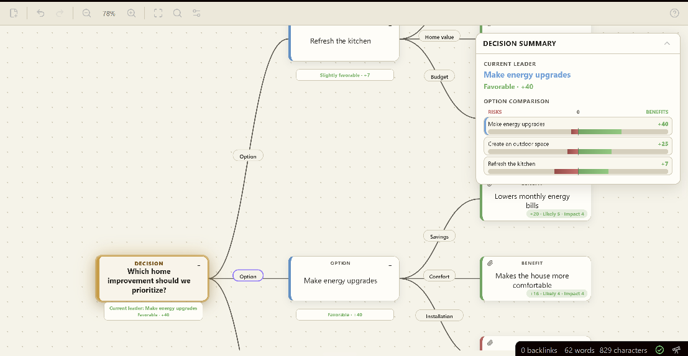
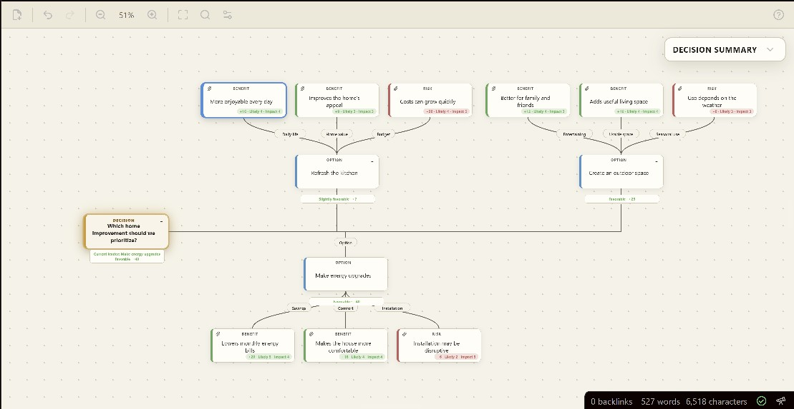
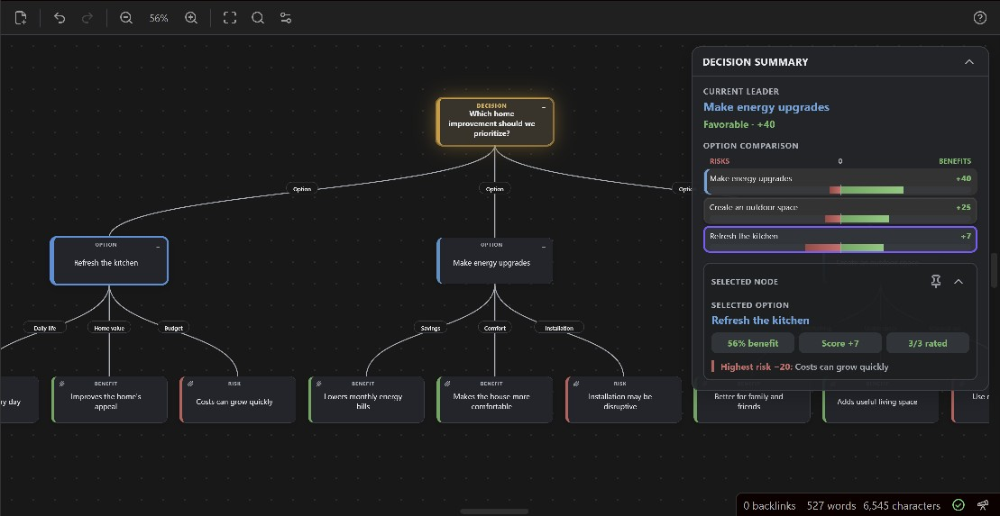

<h1> The Kempf Simple Decision Helper</h1>

**Turn a difficult choice into a decision you can see, compare, and explain.**



Big decisions rarely arrive as neat lists. The Kempf Simple Decision Helper turns competing thoughts into a clear visual map: add your choices, place the likely benefits and risks beneath them, and rate what matters to you. The Decision Summary then shows which option has the strongest support and why.

Use it to compare purchases, home projects, education or career paths, family options, and other choices that feel stuck. No spreadsheet or decision-theory experience is needed, and every recommendation remains transparent and editable.

<p align="center">
  
  
</p>

## What it helps you do

- **See the whole choice clearly.** Turn scattered thoughts into Options, Benefits, Risks, and smaller sub-options.
- **Compare choices fairly.** Rate Likelihood and Impact on simple 1–5 scales and see every option on the same −100 to +100 scale.
- **Understand the recommendation.** The Decision Summary shows the current leader, the balance of benefits and risks, and warnings when more information may be needed.
- **Keep important context.** Add supporting notes that explain why a rating was chosen.
- **Handle real limits.** Mark a Risk as a deal-breaker when it makes an option unacceptable regardless of its score.
- **Stay focused as the map grows.** Collapse, focus, lock, search, and dim branches without changing the decision itself.
- **Share the result.** Create readable reports, images, PDFs, and a polished presentation brief.
- **Keep your decisions private.** Everything stays inside your Obsidian vault, with no account, analytics, AI service, or internet connection required.

## Quick start

Begin with a blank decision or preview a template for a Simple Choice, Buy or Keep decision, Education/Training choice, or Home Improvement project.

1. Create a new decision from the ribbon icon or command palette.
2. Write the question, choose a starting template, and use Preview to inspect it before creation.
3. Add each realistic choice as an **Option**.
4. Add **Benefits** and **Risks** beneath each option.
5. Rate each factor for **Likelihood** and **Impact**, from 1 to 5.
6. Compare the options in the Decision Summary.

## Layouts and appearance

The visual layout picker previews every arrangement before it is applied:

- **Standard:** Top-facing, Bottom-facing, Left-facing, and Right-facing.
- **Staggered:** Up, Down, Left, and Right trunks with alternating branches.
- **Linear:** Up or Down sequences with Left or Right branches, plus Left or Right sequences with Up or Down branches.

Each decision can use **Obsidian Default**, **Dark**, or **Paper**. Changing a layout or background does not alter nodes, ratings, or scores.

## The scoring model

Every benefit and risk receives a factor score:

```text
Factor score = Likelihood × Impact
```

Each factor therefore contributes between 1 and 25 points.

An option's normalized score is:

```text
Option score = ((Total benefits − Total risks) ÷ (Rated factors × 25)) × 100
```

Scores range from −100 to +100:

| Score | Plain-language meaning |
|---:|---|
| +20 to +100 | Favorable |
| +5 to +19 | Slightly favorable |
| −4 to +4 | Balanced |
| −19 to −5 | Slightly unfavorable |
| −100 to −20 | Unfavorable |

Because the score is normalized, adding more factors does not automatically improve or damage an option. What matters is the balance and strength of the rated evidence.

The main Decision score is the score of the strongest eligible top-level option.

## Sub-options

An Option with child Options can use one of two modes:

- **Single Path:** the child options are alternatives. The strongest eligible path represents that branch.
- **All Paths:** every child option is part of the same plan. Their benefits and risks are combined.

The mode appears directly on an Option node that contains sub-options.

If an All Paths sub-option has no rated benefits or risks, the plugin identifies that required path as unevaluated and warns that it was excluded from the numerical score.

## Deal-breakers

A risk can be marked as a **Deal-breaker** when it makes an option unacceptable regardless of its numerical score. A blocked option remains visible, but it cannot become the recommendation.

Use this only for a genuine hard limit, such as an unaffordable cost, legal restriction, safety requirement, or unavailable resource.

## Supporting evidence

Benefits and Risks can include multiline **Supporting notes**. A paperclip on the map indicates that notes are attached. Select the node and open **Selected node details** to read them.

Supporting evidence does not change the score. It records why the Likelihood and Impact ratings were chosen. Markdown reports and JSON backups preserve it; visual exports keep the map compact and show only the factor title and score.

## Controls

| Action | Control |
|---|---|
| Select a node | Click or tap it |
| Edit a node | Double-click it or select it and press `F2` |
| Add a connected item | Select a Decision or Option and press `Enter` or `Tab` |
| Add a Benefit | Select an Option and press `B` |
| Add a Risk | Select an Option and press `D` |
| Move through the tree | Arrow keys |
| Delete a branch | Select it and press `Delete` |
| Collapse or expand a branch | Select the minus or numbered badge in the node's upper-right corner, or press Space |
| Focus or unfocus a branch | Open the node menu and choose Focus branch; use Unfocus in the toolbar to return |
| Fit the visible decision | Select Fit decision in the toolbar or background menu |
| Search node titles | Select Search nodes or press `Ctrl/Cmd+F`; use Enter and Shift+Enter to move through matches |
| Pan | Drag the background with the left or middle mouse button |
| Zoom from 5% to 200% | Mouse wheel, toolbar buttons, or two-finger pinch |
| Open menus | Right-click, or press and hold on a touchscreen |
| Undo | `Ctrl/Cmd+Z` |
| Redo | `Ctrl/Cmd+Shift+Z` or `Ctrl/Cmd+Y` |

Branches can also be moved by dragging them onto a valid Decision or Option node. Complete branches can be copied and pasted from the node menu.

The canvas provides a large amount of space in every direction, so the map can be moved well away from its starting position while exploring a decision.

Collapsing a branch hides its descendants without removing them or changing the decision score. Markdown reports and JSON backups always include the complete decision. Visual exports match the branches currently shown on the map.

Decision Options can dim unrelated branches. When a non-root node is selected, its ancestors and descendants remain clear while other branches fade, making the selected path easier to follow.

**Focus branch** keeps the selected node, its descendants, and its path back to the Decision visible while hiding unrelated branches. Node positions and decision scores do not change. Use **Unfocus** in the toolbar or background menu to reveal the complete map again. Visual exports match the focused view.

## Files, backups, and reports

- `.ksdh` is the editable decision-map file stored in the vault.
- JSON is the exact backup format and the only format that can be imported.
- Markdown creates a readable decision report. It is not a restorable backup.
- SVG and JPG create shareable images.
- PDF creates a printable one-page overview.
- Presentation PDF creates a polished Letter-size decision brief with the recommendation, comparison chart, warning, strongest benefits, greatest risks, and leading option snapshots. It stays compact when possible and adds clearly divided continuation pages when the content cannot fit. A Save/Cancel preview shows every page before the system save dialog.

## Current release

The current stable release is **1.0.0**. See the [changelog](CHANGELOG.md) for release history.

## Installation

### Install from Obsidian

The plugin is available in the Obsidian Community Plugins directory:

1. Open **Settings → Community plugins**.
2. Select **Browse**.
3. Search for **The Kempf Simple Decision Helper**.
4. Select **Install**, then **Enable**.

### Manual installation

1. Download `main.js`, `manifest.json`, and `styles.css` from the matching GitHub release.
2. Create this folder inside the vault:

```text
.obsidian/plugins/kempfs-simple-decision-helper/
```

3. Place the three files in that folder.
4. Restart Obsidian.
5. Enable the plugin under **Settings → Community plugins**.

## Privacy

The Kempf Simple Decision Helper works entirely inside Obsidian. It does not use artificial intelligence, connect to external services, collect analytics, or transmit decision data.

## Limitations

- A score reflects the information and ratings supplied by the user; it cannot guarantee the correct decision.
- Factors that are difficult to predict may deserve further research before rating.
- Extremely large image exports may be limited by the device's available memory.
- JSON backups should be stored safely when a decision is important.

## Documentation

See [HELP.md](HELP.md) for the full plain-language guide.

## License

Released under the [MIT License](LICENSE).
